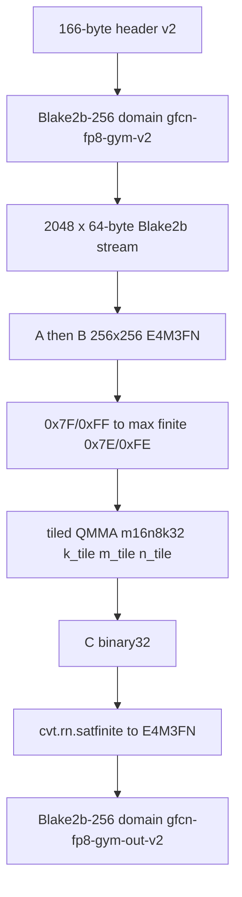

# FP8 gym (kind 2)

Frozen at genesis. Pin card: RTX 5070 Ti. Dimension, tile order, and
rounding do not change in a later release. Other chips mine this kind
only if they emit these bits. Golden digests in `fp8_gym_tests` are
the 5070 Ti dump.

IEEE `cvt.rn.satfinite` is the hardware pack name. It is not the flex
leftover-hole predicate `Saturated()`.

Classify then visit (no nested IEEE/E4M3 sniff in the QMMA lane):

1. Each A/B byte is `E4M3NaN`, `E4M3SignedZero`, or `E4M3FiniteNonZero`.
2. Each accumulator cell is `IeeeFp32NaN`, `IeeeFp32Inf`, `IeeeFp32Zero`, or `IeeeFp32Finite`.
3. One k=32 lane fused-accumulates 32 products plus C at 25 fraction bits, then RZ-normalizes to binary32 (overflow to inf, underflow to subnormal, else normal).
4. Packed C is digested. That digest is the work for `nBits`.
